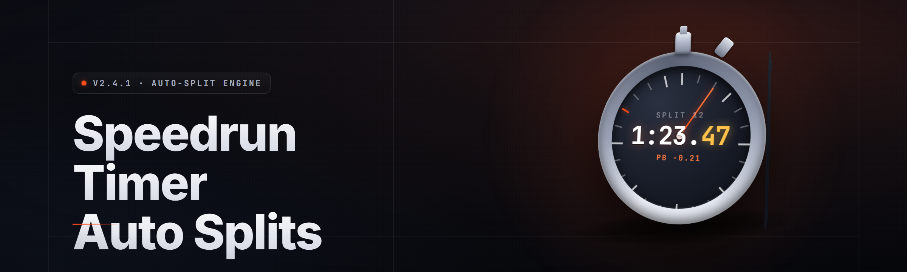

  
  
  

  

  
  

---

Auto-splitting speedrun timer for runners — reads memory client-side to fire splits on game events, no manual keybinds on PC.

## Overview

Auto-splitting speedrun timer for runners — reads memory client-side to fire splits on game events, no manual keybinds on PC.

  

## License

[MIT License](LICENSE)

  

